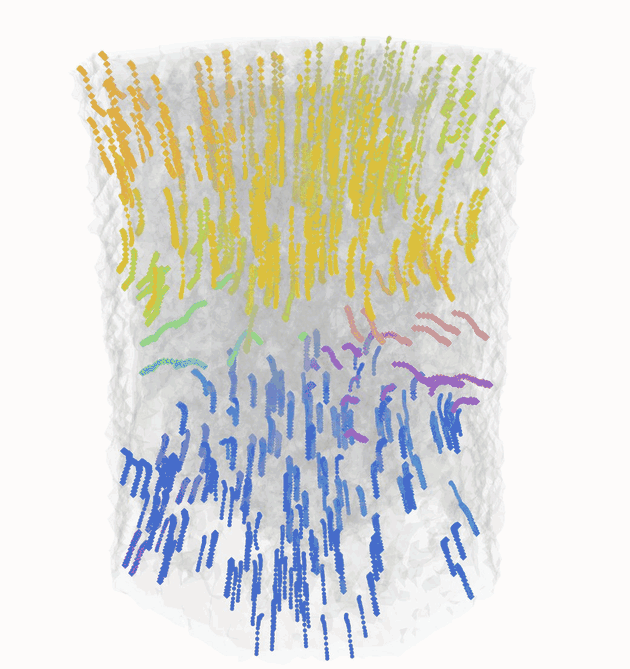
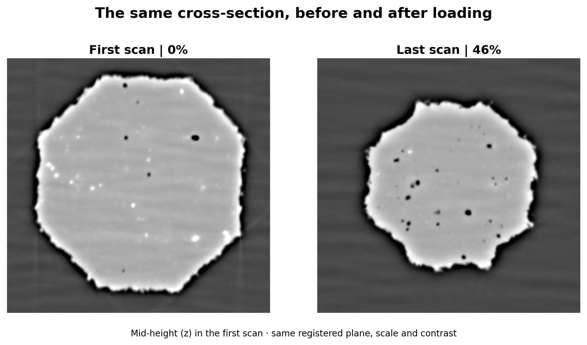
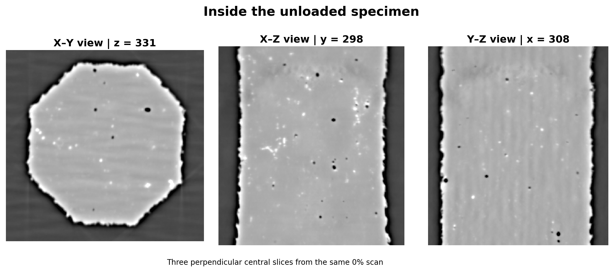
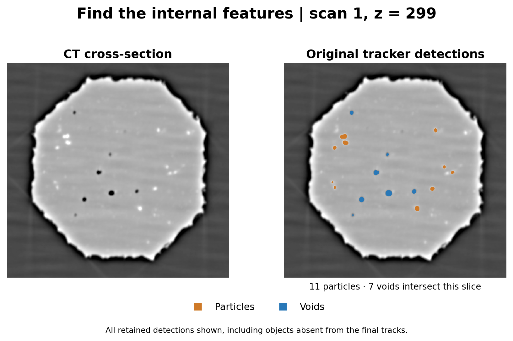
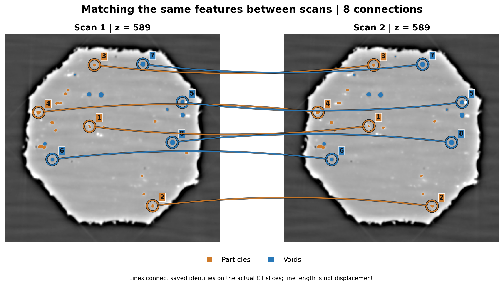

# Tracking Particles and Voids inside a deformed sample

**Author**: Christian Bjerregaard  
**Email:** s224389@dtu.dk  
**Affiliation**: [QIM](https://qim.dk)  
**Collaborating department**: DTU Construct  
**Collaborators**: Michela La Bella (supervision), Grethe Winther (supervision), Axel Henningsson (collaborator), and Felix Frankus (collaborator).  
**Date**: October 21, 2026

<figure style="text-align: center;">
    
    <figcaption>
        <em>Following internal features through successive deformation steps makes their movement visible in three dimensions. The animation rotates the view of the found trajectories.</em>
    </figcaption>
</figure>

## Following the changes inside a deformed sample

To study what happens inside an aluminium sample as it deforms, researchers at DTU Construct used synchrotron phase contrast tomography to scan the sample at successive deformation steps. They wanted to follow the movement of individual copper-rich intermetallic particles and voids (small empty spaces within the material) throughout the experiment. This requires recognising the same features from one three-dimensional scan to the next, even as their positions and shapes change.

<figure style="text-align: center;">
    
    <figcaption>
        <em>Phase contrast tomography cross-sections of the sample before loading (left) and at the final deformation step (right). Both images show the same plane in the aligned scans, using the same scale and contrast.</em>
    </figcaption>
</figure>

## Looking inside a changing material

When a sample deforms, its internal structure changes too. Phase contrast tomography lets researchers look inside the sample without cutting it open. Repeating the scan at successive deformation steps provides a series of three-dimensional views.

Within these views, small bright solid particles and empty spaces called voids provide features to follow. The scans show where those features are at each step. Connecting them across the series is what allows researchers to examine the history of individual objects.

In this collaboration with DTU Construct, we developed an image-analysis workflow to make that connection:
- Identify particles and voids,
- Follow them between scans,
- And export their positions, sizes and shapes for further analysis.

<figure style="text-align: center;">
    
    <figcaption>
        <em>Three perpendicular slices through the same sample before loading. Particles are seen as very bright spots, and voids as very dark spots.</em>
    </figcaption>
</figure>

## Finding the features worth following

A phase contrast tomography image contains more than the features of interest. Noise, a bright sample boundary and differences in image contrast can make a simple brightness cutoff unreliable.

Our method treats particles and voids differently. It searches for bright particle-like features within the sample interior, separates neighbouring detections and removes small regions. Voids are identified as connected dark regions inside the sample. This produces labelled objects that can be measured and compared between scans. A minimum size is chosen for when a particle or void is considered of interest to reduce potential noise. Larger objects are more stable to track.

<figure style="text-align: center;">
    
    <figcaption>
        <em>The same phase contrast tomography slice before and after feature identification. Orange marks detected particles and blue marks detected voids. These are detections at one step. Only a subset becomes retained trajectories. Note not all visible particles are chosen. This is due to their total volume being below the set threshold.</em>
    </figcaption>
</figure>

## Recognising the same object later

Finding a particle in one scan does not tell us which particle it is in the next. As the sample deforms, objects move and can change appearance. Selecting the nearest object alone can give the wrong answer.

Our method compares position, size, shape, brightness and the surrounding features. Reliable matches help estimate how nearby objects move, guiding the next set of matches. A further pass examines interrupted tracks across several scans and selects compatible continuations without assigning one detection to multiple tracks.

<figure style="text-align: center;">
    
    <figcaption>
        <em>Numbered examples link the same detected features between two scans. The connecting lines indicate identity; their lengths across the two panels do not represent physical displacement. Matching uses the full 3D objects, even though this illustration shows a single slice.</em>
    </figcaption>
</figure>

## A tool for further investigation

The result of this work is a workflow for following internal features and preparing their measurements for the researchers' own analysis. The implementation also supports investigating newly detected voids and possible joins between voids. Those interpretations require inspection: first detection does not establish when a void physically formed, and an apparent join can depend on how the image is segmented.